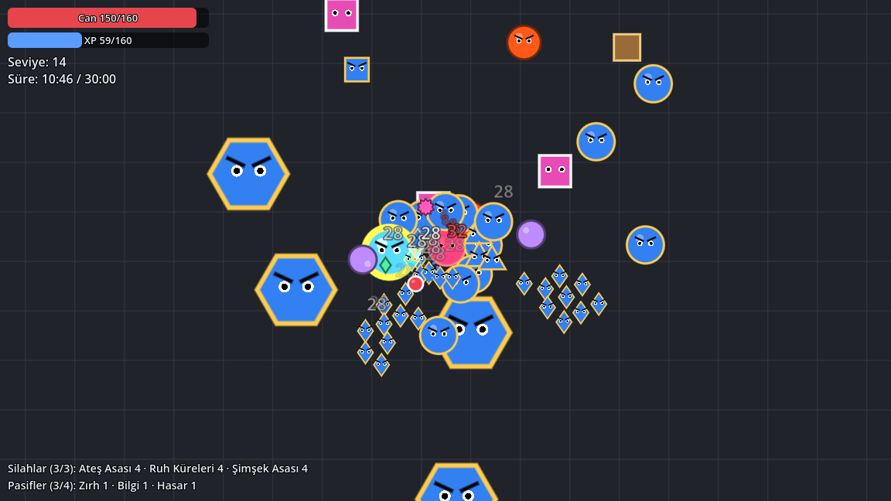
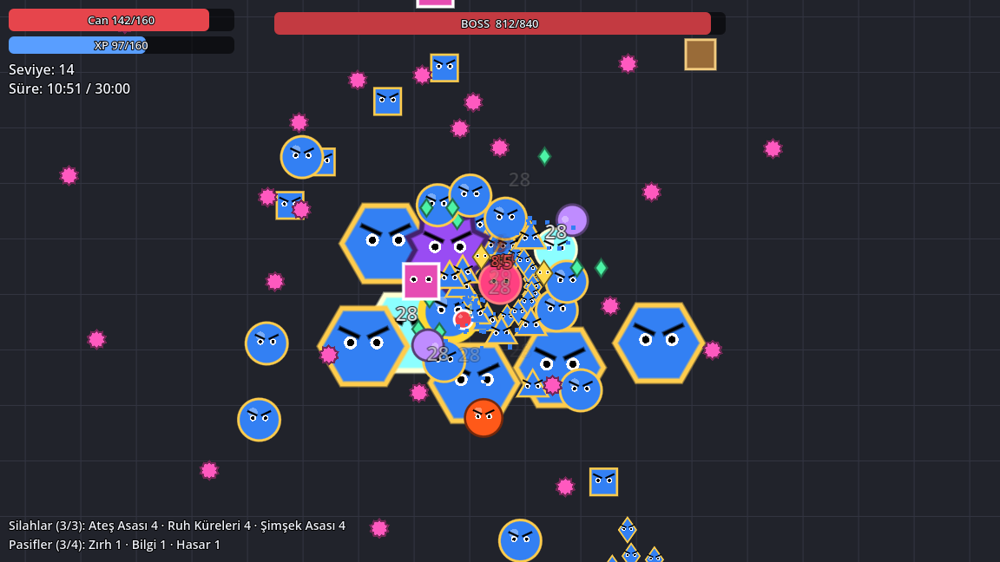
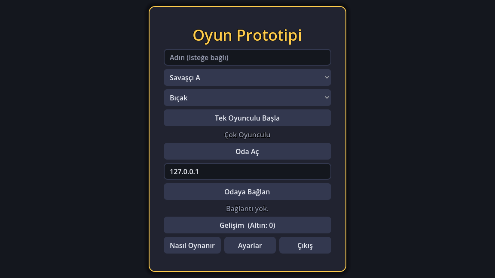
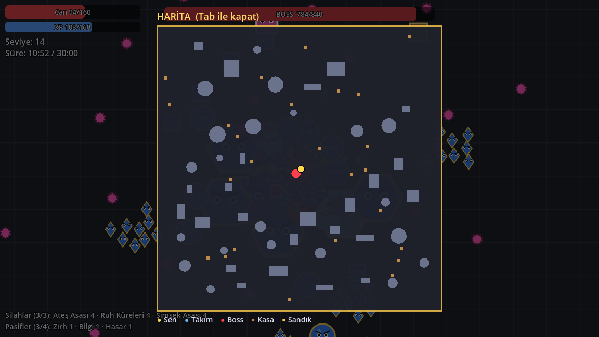

# Demo

**30 dakika hayatta kal. Arkadaşlarınla birlikte.**

**Demo**, 1–4 kişilik co-op bir *survivors* oyunu: karakterin otomatik saldırır, sen hareket edip düşman dalgalarından kaçarsın, seviye atladıkça silah ve güç toplarsın. Her 5 dakikada düşmanlar güçlenir ve bir mini boss gelir; 30. dakikada son boss seni bekler.

> ⚠️ Oyun **geliştirme aşamasında**; "Demo" geçici adı. Çizimler geçici (pixel art gelecek), denge ayarları test ediliyor. Gördüğün hataları ve fikirlerini yazarsan çok yardımcı olur!

---

## 📥 İndir ve kur

**[👉 En son sürümü indir](https://github.com/HasanBersan/demo-oyun/releases/latest)**

Sayfanın altındaki **Assets** bölümünden işletim sistemine uygun dosyayı indir.

### Windows
1. `Demo-windows.zip` dosyasını indir ve bir klasöre çıkart.
2. `Demo.exe` dosyasını çalıştır.
3. "Windows bilgisayarınızı korudu" uyarısı çıkarsa: **Ek bilgi** → **Yine de çalıştır**.
   *(Oyun dijital olarak imzalı olmadığı için bu uyarı çıkıyor.)*
4. Oda açtığında Windows Güvenlik Duvarı izin isterse **İzin ver**'e bas; yoksa arkadaşların sana bağlanamaz.

### macOS
1. `Demo-macos.zip` dosyasını indir ve çift tıklayıp aç.
2. `Demo` uygulamasına **sağ tıkla → Aç**.
3. "Apple doğrulayamadı" uyarısı çıkarsa: **Sistem Ayarları → Gizlilik ve Güvenlik** → en altta **Yine de Aç**.
   *(Oyun Apple tarafından imzalı olmadığı için bu bir kerelik uyarı çıkıyor.)*

---

## 🎮 Arkadaşlarınla oyna

Bir kişi **oda açar** (host), diğerleri o odaya **bağlanır**. En fazla 4 kişi.

### Aynı evdeyseniz (aynı Wi‑Fi)
1. Host: ana menüde **Oda Aç**.
2. Lobide **"Aynı evden: 192.168.x.x"** yazar. **Adresi kopyala**'ya basıp arkadaşlarına gönder.
3. Arkadaşlar: adresi IP kutusuna yazıp **Odaya Bağlan**.
4. Herkes lobide görününce host **Oyunu Başlat**'a basar.

### Farklı evlerdeyseniz (internet üzerinden)
Bunun için ücretsiz **[Tailscale](https://tailscale.com/download)** programını kullanıyoruz. Bilgisayarlarınızı sanki aynı evdeymişsiniz gibi birbirine bağlar; modem ayarlarıyla uğraşmazsınız.

1. **Herkes** Tailscale'i indirip kurar ve bir hesapla (Google, Microsoft vb.) giriş yapar.
2. **Host**, [Tailscale yönetim panelinde](https://login.tailscale.com/admin/machines) kendi bilgisayarının satırındaki **Share** ile bilgisayarını arkadaşlarıyla paylaşır. Arkadaşlar e‑postalarına gelen daveti kabul eder.
3. Host oyunda **Oda Aç**'a basar. Lobide **"Farklı evden (Tailscale): 100.x.x.x"** yazar; **Adresi kopyala** ile arkadaşlarına gönderir.
4. Arkadaşlar bu adresi IP kutusuna yazıp **Odaya Bağlan**.

> Bağlanamıyorsanız: Tailscale herkeste açık mı? Host'un güvenlik duvarı oyuna izin veriyor mu? Herkes aynı sürümü mü kullanıyor?

---

## 🕹️ Nasıl oynanır

| Tuş | İş |
|---|---|
| **WASD** / ok tuşları | Hareket |
| *(otomatik)* | Saldırı: silahların menzildeki düşmanlara kendisi saldırır |
| **Tab** | Tam harita |
| **ESC** | Menü (tek oyunculuda oyunu durdurur) |

- **Seviye atla:** Düşmanlardan düşen yeşil XP taşlarını topla. Her seviyede 3 seçenekten birini al: yeni silah (en fazla 3) ya da pasif güç (en fazla 4).
- **Evrim ★:** 5. seviyedeki bir silahın eşi olan pasif de sendeyse, bir boss'u yenip düşen **büyük sandığı** açınca silahın güçlü haline dönüşür. Oyun içindeki **Nasıl Oynanır** ekranında bütün evrimlerin listesi var.
- **Co-op:** Ölen takım arkadaşının yanında 3 saniye durursan onu canlandırırsın. **Şifacı** sınıfı yakınındaki herkesi iyileştirir.
- **Gelişim:** Her maç sonunda altın kazanırsın; ana menüdeki **Gelişim**'den kalıcı güçlendirmeler alırsın.

### İçerik
- **6 karakter, 4 sınıf:** Savaşçı, Büyücü, Okçu, Şifacı
- **22 silah, 22 evrim:** yakın dövüş, mermi, zincir şimşek, dönen kılıçlar, bumerang, ok yağmuru…
- **Düşmanlar:** 6 kademe (her 5 dakikada güçlenirler), elitler, bölünen ve patlayan düşmanlar
- **5 farklı mini boss** ve **son boss**
- Her maçta değişen **kayalık arena**, kırılabilir kasalar, iksir ve mıknatıs

| Ana menü | Harita (Tab) |
|---|---|
|  |  |

---

## 💬 Geri bildirim

Hata bulduysan ya da bir fikrin varsa bu sayfadaki **Issues** sekmesinden yazabilirsin (ya da doğrudan bana söyle). Özellikle şunları merak ediyorum:
- Hangi dakikada zorlandın, ne öldürdü?
- Hangi silah/sınıf çok güçlü ya da çok zayıf geldi?
- Oyun takıldı mı (çok düşman olunca)?
