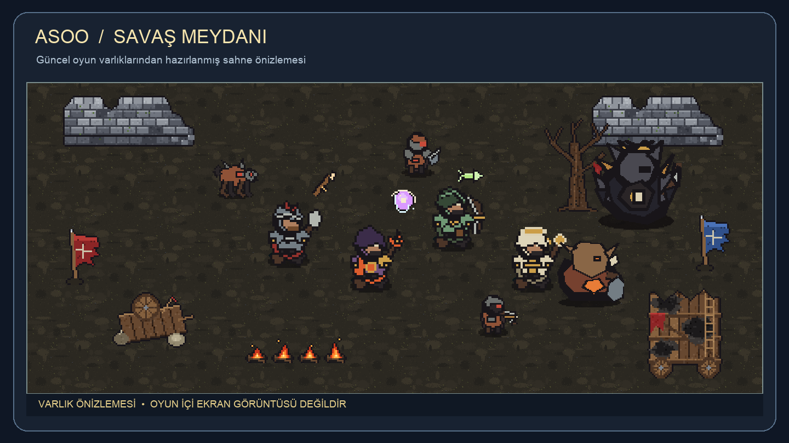
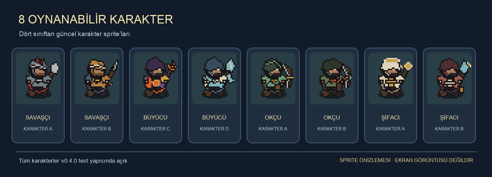

# ASOO

**30 dakika hayatta kal. Arkadaşlarınla birlikte.**

ASOO, 1–4 kişilik çevrimiçi co-op bir *survivors* oyunudur. Silahlar otomatik saldırır; oyuncular hareket ederek düşman dalgalarından kaçar, XP toplar ve seviye atladıkça silah veya pasif güç seçer. Normal maç yaklaşık 30 dakika sürer; haritaya ve moda göre süre değişebilir.

Haritalarda isteğe bağlı event işaretleri belirir. Eventleri tamamlayarak altın, Ruh Taşı, karakterler, oyun modları ve Kalıntılar kazanırsın.

> **v0.4.0 test sürümü:** Sekiz karakterin tamamı açık. Yeni Savaş Meydanı haritası, piksel-art görseller ve yenilenmiş oyun arayüzü bu sürüme dahil.
>
> **Bilinen sınırlamalar:** Maç sırasında bağlantısı kopan oyuncu yeniden katılamaz. İki cihazla internet/Tailscale bağlantı testi henüz tamamlanmadı. macOS paketi gerçek bir Mac'te ilk açılış testinden geçmedi.

---

## 📥 İndir ve kur

**[👉 ASOO v0.4.0 test sürümünü indir](https://github.com/HasanBersan/demo-oyun/releases/tag/v0.4.0)**

Release sayfasındaki **Assets** bölümünden işletim sistemine uygun ZIP dosyasını indir.

### Windows
1. `ASOO-windows.zip` dosyasını indirip bir klasöre çıkart.
2. İçindeki `Demo.exe` dosyasını çalıştır.
3. Windows koruma uyarısı çıkarsa **Ek bilgi → Yine de çalıştır** seçeneğini kullan.
4. Oda açarken güvenlik duvarı sorarsa oyuna izin ver.

### macOS
1. `ASOO-macos.zip` dosyasını indirip aç.
2. İçindeki `Demo.app` uygulamasına sağ tıklayıp **Aç**'ı seç.
3. macOS uygulamayı doğrulayamazsa **Sistem Ayarları → Gizlilik ve Güvenlik → Yine de Aç** yolunu izle.

---

## 🎮 Arkadaşlarınla oyna

Bir kişi oda açar (host), diğerleri bağlanır. En fazla 4 kişi oynayabilir.

### Aynı Wi‑Fi'de
1. Host ana menüden **Oda Aç**'ı seçer.
2. Lobide gösterilen yerel IP adresini arkadaşlarına gönderir.
3. Diğer oyuncular adresi IP kutusuna yazıp **Odaya Bağlan**'ı seçer.
4. Herkes lobide görünce host **Oyunu Başlat**'a basar.

### Farklı ağlarda
İnternet/Tailscale bağlantısı iki cihazla henüz doğrulanmadı. Bağlantısı maç sırasında kopan oyuncu yeniden katılamaz.

---

## 🕹️ Nasıl oynanır

| Tuş | İş |
|---|---|
| **WASD** / ok tuşları | Hareket |
| *(otomatik)* | Saldırı |
| **Tab** | Tam harita |
| **ESC** | Menü / duraklat |

Düşmanlardan düşen XP taşlarını topla ve seviye atladıkça silah ya da pasif güç seç. Silahları eşleşen pasiflerle geliştir; boss sandıklarından evrim kazan. Takım arkadaşını yerdeyken yanında 3 saniye durarak canlandırabilirsin.

## ✨ İçerik

- 8 karakter, 4 sınıf
- 34 temel silah ve 34 evrim
- 2 harita teması
- 12 isteğe bağlı event ve 1 otomatik Sürü Dalgası
- Normal, Sonsuz, Zor, Hızlı Maç ve Boss Akını modları
- 5 mini boss, son boss ve kalıcı Kalıntılar

---

## 💬 Geri bildirim

Hata bildirmek veya fikir paylaşmak için GitHub **Issues** sekmesini kullan. Hata raporuna oyunun dakikasını, seçtiğin karakteri ve oyun modunu ekle.
